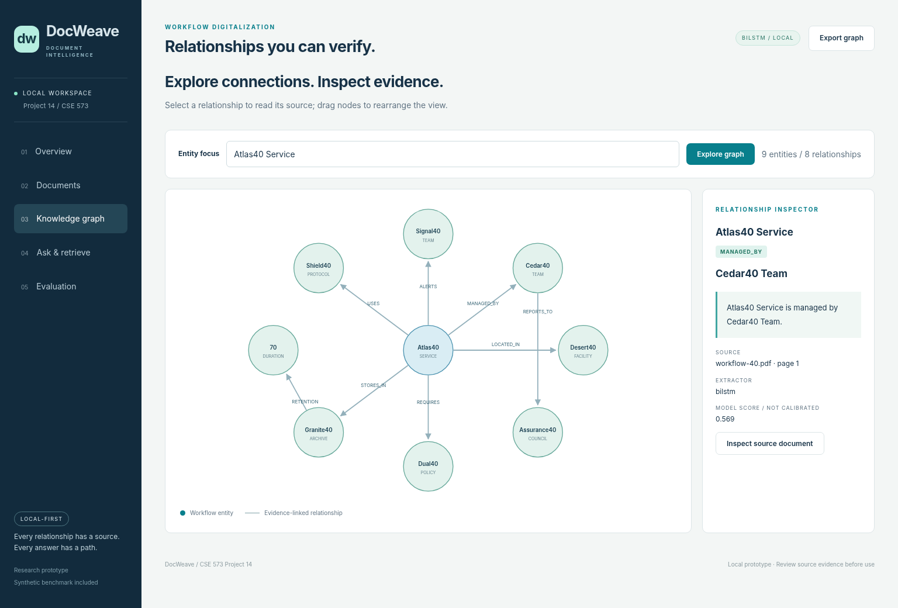

# DocWeave
## Evidence-linked PDF knowledge graphs for workflow digitalization

CSE 573 / Project 14 / Fall 2026. **Group number and full team roster are not yet supplied.**

DocWeave is a runnable, local-first research prototype: PDF/native-text extraction, OCR fallback, classical and neural relation extraction, evidence-linked graph storage, constrained two-hop question answering, and an interactive browser interface. The repository includes an original **synthetic** benchmark, measured results, automated tests, a report, and a 10-slide demo.

**This is an AI-assisted generated reference implementation, not a reconstruction of an existing team's work.** The dataset is fictional. Do not represent the generated experiments or code as previously completed team work. Verify the course's AI-use policy and complete the actual contribution statements before submitting.



## Start the application

Use Python 3.11-3.13. The recorded run used Python 3.13.5 on Linux, CPU only. A fresh virtual environment is recommended.

```bash
python3 -m venv .venv
source .venv/bin/activate
python -m pip install -r requirements.txt
python CODE/run.py seed
python CODE/run.py serve
```

Windows PowerShell activation: `.venv\Scripts\Activate.ps1`.

Open **http://127.0.0.1:8000**. The server intentionally binds only to loopback. Keep the terminal open while using the application. `Ctrl+C` stops it. No cloud key or external service is required by the included demo. The included neural weights were trained on this synthetic dataset; they are not pretrained foundation-model weights.

For scanned PDFs, install **Tesseract with English language data** separately. On macOS: `brew install tesseract`. On Debian/Ubuntu: `sudo apt-get install tesseract-ocr tesseract-ocr-eng`. A missing OCR engine is reported rather than silently returning invented text. Native-text PDFs do not invoke OCR.

### A concrete demonstration

Select **Documents**, open `workflow-40.pdf`, and inspect its eight extracted relationships. Select **Knowledge graph** and focus on `Atlas40 Service`. In **Ask & retrieve**, submit:

```text
Which council supervises the team managing Atlas40 Service?
```

The graph follows `Atlas40 Service -> MANAGED_BY -> Cedar40 Team -> REPORTS_TO -> Assurance40 Council`, with two exact source quotes. Then ask `What is the annual budget of Atlas40 Service?` to demonstrate an explicit abstention.

## What is implemented and what is not

| Capability | Status |
|---|---|
| Native PDF extraction, page previews, conservative chunking | Implemented and exercised on 48 native PDFs |
| Image-only OCR fallback | Implemented; four derived scan pages actually processed in one Tesseract batch |
| Rule and TF-IDF/logistic baselines | Implemented and evaluated |
| BiLSTM relation classifier | Implemented, trained from scratch, and evaluated; 21,705 parameters |
| Evidence-linked SQLite graph, JSON/CSV exports | Implemented and tested |
| Graph-guided retrieval and constrained two-hop answers | Implemented and evaluated; handcrafted question planner |
| Browser document, graph, search and evaluation views | Implemented; seven browser smoke checks using a local API bridge |
| Local Ollama LLM triplet extractor | Optional adapter implemented; validation tested; **live model not evaluated** |
| Neo4j parameterized graph export | Optional adapter implemented; **live server not evaluated** |
| Docling Markdown conversion | Optional adapter implemented; **not evaluated** |
| LlamaCloud, general legal reasoning, dense pretrained retrieval | **Not implemented or claimed** |
| Production multi-user security / usability study | **Not performed** |

The native entity recognizer targets names ending in `Service`, `Team`, `Archive`, `Policy`, `Facility`, `Protocol`, or `Council`, plus durations such as `70 days`. It is deliberately a **closed schema**, not a general named-entity recognizer. Arbitrary invoices, handwriting, complex tables, multi-column layouts, non-English text, aliases, and pronoun resolution are outside the tested scope. PDFs can yield readable text without yielding supported graph facts.

## Measured results

All numbers below come from `EVALUATIONS/results/metrics.json`, not assumed scores.

| Measure | Rule baseline | Logistic regression | BiLSTM |
|---|---:|---:|---:|
| Standard-test relation macro F1 (90 statements) | 0.647 | 1.000 | 1.000 |
| Unseen-paraphrase macro F1 (72 positive statements) | 0.000 | 0.833 | 0.708 |
| Exact test-triple F1 (72 affirmative facts) | 0.667 | 1.000 | 1.000 |

TF-IDF evidence Recall@5 was **0.741**; graph-assisted Recall@5 was **1.000** on 54 answerable questions. Complete evidence coverage on 18 two-hop questions was **0.000** versus **1.000**. The graph planner is tailored to the benchmark schema and query families; these figures are not general-domain claims. The classical model outperformed the neural model on unseen phrasing. The default neural mode demonstrates the learned sequence model, not superiority over the classical model.

OCR character error rate was **3.80%** and word error rate **3.72%** on four derived pages. Those are correlated scan smoke tests, not independent real-world documents. High normal-test scores reflect simple, template-generated data; train/dev/test entities are disjoint, but normal-test phrasing families overlap training.

## Reproduce the experiments

```bash
python -m pip install -r requirements-dev.txt
python CODE/tools/generate_dataset.py
python CODE/tools/train_models.py
python CODE/tools/evaluate.py
python -m pytest -q --junitxml=EVALUATIONS/results/tests.xml
python CODE/tools/build_figures.py
```

Generation, training, and evaluation use seed **573**. The evaluation reads actual native PDF text, not the gold record strings, for end-to-end extraction. Gold labels are consulted only by the evaluator. Training uses 300 statements from 30 PDFs, checkpoint selection uses 90 statements from nine development PDFs, and the normal test uses nine other PDFs. The separate 72-statement stress slice uses held-out phrasing templates. There was no hyperparameter search on the test split.

Evaluation does not delete or replace the application database. Run `python CODE/run.py seed` to load/reload the fictional demo documents, preserving other documents. Runtime files and uploaded PDFs are excluded from Git.

To capture the running interface:

```bash
python -m playwright install chromium
python CODE/run.py serve
# In another terminal:
python CODE/tools/capture_ui.py
```

The artifact environment restricted direct browser network navigation. Its recorded browser run used `capture_ui.py --bridge`, which renders the actual HTML/CSS/JavaScript and relays fetch calls to the running local API. The screenshots are real application renders, not design mockups. Normal direct-browser navigation must still be verified on the team's machine.

## Repository layout

```text
CODE/             Python pipeline, API, UI, tests and build tools
DATA/             Fictional PDFs, scans, labels, trained models, processed evidence
EVALUATIONS/      Raw predictions, per-query results, metrics, test logs, figures, screenshots
SUBMISSION/       Report PDF + IEEE LaTeX source, demo PPTX/PDF and speaker notes
DOCS/             Architecture, dataset/model scope, security, demo and submission guides
PROJECT_METADATA.json   Actual group, members, contributions and repository URL
```

## Report and demo

The supplied assignment-specific announcements require a **5-10 page report**, an approximately **10-slide / 12-minute demo**, and one upload per group. Those later instructions are used rather than the older slide deck's 15-20 pages and 15-minute guidance. The report deadline in the announcement is **December 9, 2026 at midnight**; verify Canvas's exact displayed due time.

The delivered files use `GroupTBD` until the actual group number is supplied. **They are not cleared for final upload while metadata and contribution checks fail.** Fill `PROJECT_METADATA.json`, including every real team member and concrete contribution evidence, then run:

```bash
python CODE/tools/build_report.py
python CODE/tools/build_demo.py
python CODE/tools/validate_submission.py
```

Report rebuilding requires `pdflatex` and `bibtex` with `IEEEtran`; slide-PDF rebuilding requires LibreOffice. The editable `.tex`, `.pptx`, Python generation scripts, and reference bibliography are included. Do not compress fonts or remove limitations to fit the page count.

## Publish to GitHub

No remote GitHub repository was created by the artifact build: no authenticated GitHub connector, token, or repository URL was available. The included helper creates a **new private repository by default**, refuses to overwrite an existing repository, and never asks for a token in source code.

```bash
gh auth login
bash CODE/tools/publish_github.sh YOUR_ACCOUNT/docweave-project14
```

This requires Git and the GitHub CLI installed locally, an authenticated account, and a configured Git author. Pass `--public` only after checking that publication is permitted. After publishing, paste the real repository URL into `PROJECT_METADATA.json`, give the instructor access, set `repository_access_verified` after testing it, and rebuild both deliverables. The last demo slide is generated from that URL. Commit and push the rebuilt files afterward; local rebuilding does not update the remote. See `DOCS/SUBMISSION_CHECKLIST.md`.

## Optional integrations

See [DOCS/OPTIONAL_INTEGRATIONS.md](DOCS/OPTIONAL_INTEGRATIONS.md). They are not included in the reported performance numbers. Newly collected data or live-service results require a fresh experiment run and updated evidence.

## Key references

The project brief is Hasan Davulcu's CSE 573 Fall 2026 P14 slide. Technical sources are listed with provenance in [DOCS/SOURCES.md](DOCS/SOURCES.md) and in the report bibliography. Software dependencies retain their own licenses; see [THIRD_PARTY_NOTICES.md](THIRD_PARTY_NOTICES.md).
